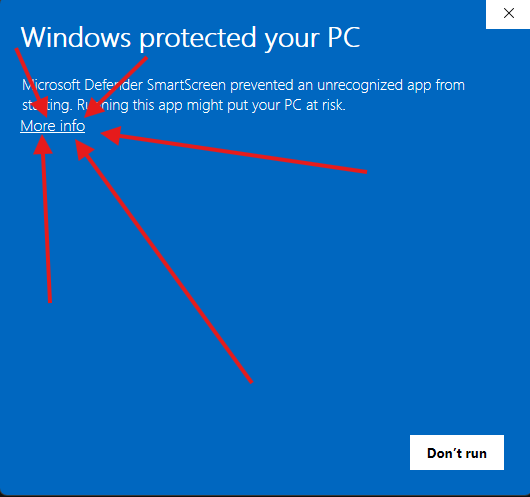
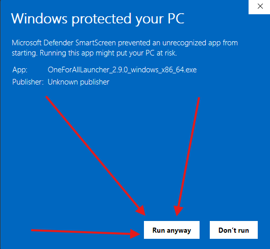

# Installation warnings and compatibility

OneForAllLauncher does not currently have trusted Windows Authenticode signing
or Apple Developer ID signing/notarization. Windows SmartScreen and macOS
Gatekeeper may warn about or block a download. Some macOS versions and hardware
combinations may also be incompatible with a particular build.

The fork's **signed automatic updates** are separate: those signatures verify
update packages using the launcher's embedded public key. They do not supply a
Windows publisher certificate or Apple notarization.

## Before opening a blocked download

Download only from [this fork's GitHub Releases](https://github.com/liwwyy/OneForAllLauncher/releases).
Compare the downloaded file's SHA-256 with its entry in that release's
`SHA256SUMS.txt`. Replace `VERSION` and the filename below with your download.

Windows PowerShell:

```powershell
Get-FileHash ".\OneForAllLauncher_VERSION_windows_x86_64.exe" -Algorithm SHA256
```

macOS Terminal (example for Apple Silicon):

```sh
shasum -a 256 ~/Downloads/OneForAllLauncher_VERSION_darwin_aarch64.dmg
```

If the checksum differs, delete the file and download it again. A matching
checksum checks file integrity; it does not mean Microsoft or Apple has reviewed
the application.

## Windows: SmartScreen / Windows protected your PC

After verifying the release and deciding to trust it:

1. Open the downloaded installer.
2. In the SmartScreen dialog, select **More info**.
3. Select **Run anyway**, if Windows offers that option.
4. Continue through the installer. An **Unknown publisher** entry is expected
   for the unsigned installer; confirm the file is the one you verified.

These are the per-download steps described in [Microsoft's SmartScreen guidance](https://learn.microsoft.com/en-us/windows/apps/package-and-deploy/publish-first-app#step-6-handle-smartscreen-for-new-apps).
If the option is unavailable because of an organizational policy, contact the
device administrator. Keep Defender and SmartScreen enabled; no global security
setting needs to be changed for these steps.

### 1. Select More info



### 2. Select Run anyway



These screenshots were supplied by the maintainer from Windows testing.

## macOS: unidentified developer / Apple cannot verify this app

1. Choose the correct release: **darwin_aarch64** for Apple Silicon (M-series)
   or **darwin_x86_64** for an Intel Mac. Find the chip under **Apple menu →
   About This Mac**.
2. Open the DMG and drag **OneForAllLauncher.app** into **Applications**. Launch
   that installed copy rather than running it from the mounted DMG.
3. If Gatekeeper blocks it, dismiss the dialog, then open **System Settings →
   Privacy & Security**. Older macOS versions call this **System Preferences →
   Security & Privacy → General**.
4. Find the message about the blocked application and choose **Open Anyway**.
5. Confirm **Open** and authenticate if macOS asks.

Apple documents this per-app exception in [Safely open apps on your Mac](https://support.apple.com/en-us/102445).
It is available only after an attempted launch, and managed devices may restrict
it. Do not disable Gatekeeper for the entire computer.

An explicit malware warning, a checksum mismatch, or an app reported as damaged
should not automatically be treated as an unsigned-app warning. Download the
correct asset again and check the exact message before proceeding; Apple's
[alert descriptions](https://support.apple.com/en-us/102445) distinguish
these cases.

## macOS: wrong architecture, unsupported OS, or launch failure

A Gatekeeper exception cannot fix a binary built for a different CPU or a missing
system API. Use the asset matching your chip and check the current release notes
for OS requirements. The package currently declares a 10.14 minimum, but that
metadata does not establish compatibility with every older Intel Mac; Apple
Silicon and native dependencies have their own OS requirements. Older macOS
versions remain subject to actual package testing.

If the installed app closes immediately, launch its executable from Terminal to
collect the error:

```sh
"/Applications/OneForAllLauncher.app/Contents/MacOS/oneforall_app"
```

Report the release version, asset filename, macOS version, Intel/Apple Silicon
chip and exact error in [a fork issue](https://github.com/liwwyy/OneForAllLauncher/issues).
Messages such as **Bad CPU type**, **requires a newer version of macOS**, or a
`dyld` missing-symbol error indicate compatibility problems. Include sanitized
terminal output; remove account names, tokens and personal paths. A correct
architecture build, an OS update, or a compatible source build may be needed.

[Return to installation](../README.md#installation).
